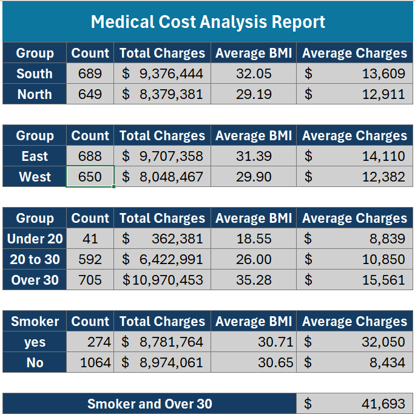
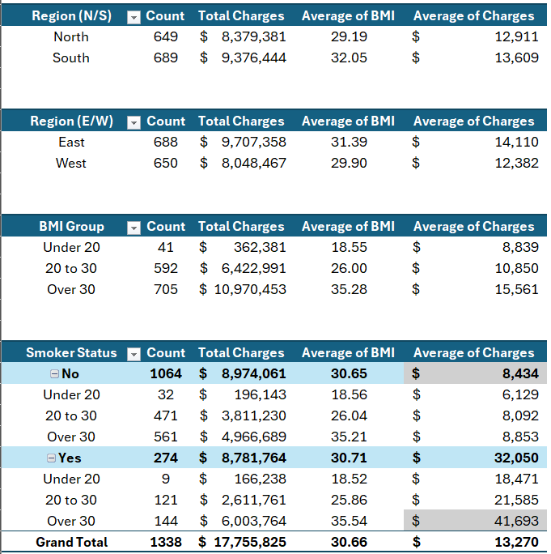

# Medical Cost Data Analysis Exercise

This project is a data analysis exercise using Medical Cost data, solving business questions related to BMI, regional grouping, and smoking habits.

## Questions Addressed

1. Group individuals into North and South regions, then calculate the number of individuals, total charges, and average BMI for each group.
2. Group individuals into East and West regions, then calculate the number of individuals, total charges, and average BMI for each group.
3. Categorize individuals into BMI groups: below 20, between 20 and 30, and above 30. Calculate the number of individuals and average charges for each group.
4. Calculate the average charges for non-smokers.
5. Calculate the average charges for smokers with a BMI above 30.

## Results

### Summary report

### Pivot tables

