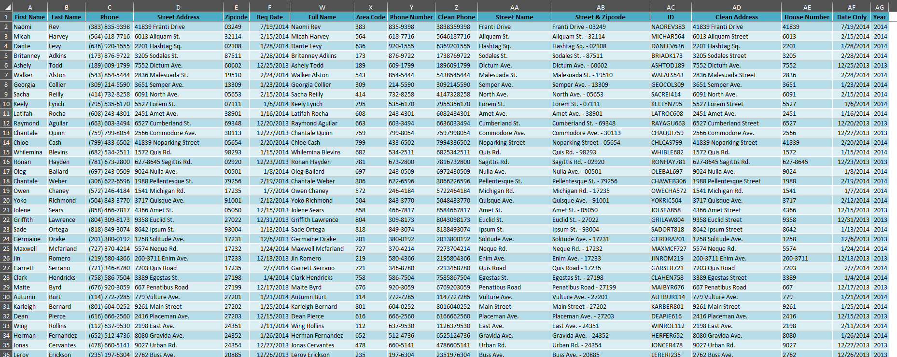
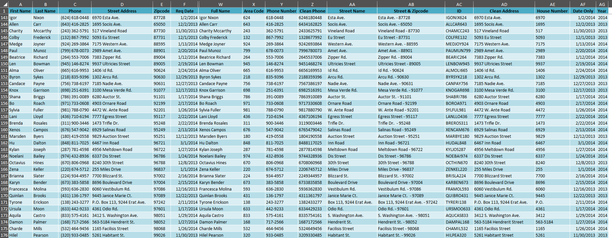

# Excel Data Cleaning Exercise

This project focuses on data cleaning and standardization using Microsoft Excel. It transforms raw customer data into a clean, structured dataset ready for analysis.

## Objectives & Tasks Performed

1. **Full Name Creation:** Combined `First Name` and `Last Name` columns.
2. **Area Code Extraction:** Extracted the 3-digit area code from phone numbers.
3. **Phone Number Formatting:** Standardized phone numbers into clean 7-digit formats and a unified numerical layout.
4. **Street Address Standardizing:** Cleaned and capitalized street address strings.
5. **Street & Zipcode Combination:** Combined street address and zipcode into a single formatted column.
6. **Unique Customer ID Generation:** Created custom IDs combining name parts and zipcode.
7. **Clean Address Assembly:** Formatted complete clean address lines.
8. **House Number Extraction:** Extracted numerical house numbers from address strings.
9. **Date Parsing:** Separated standard dates from timestamps.
10. **Year Extraction:** Derived year values for temporal grouping.

## Results Preview

