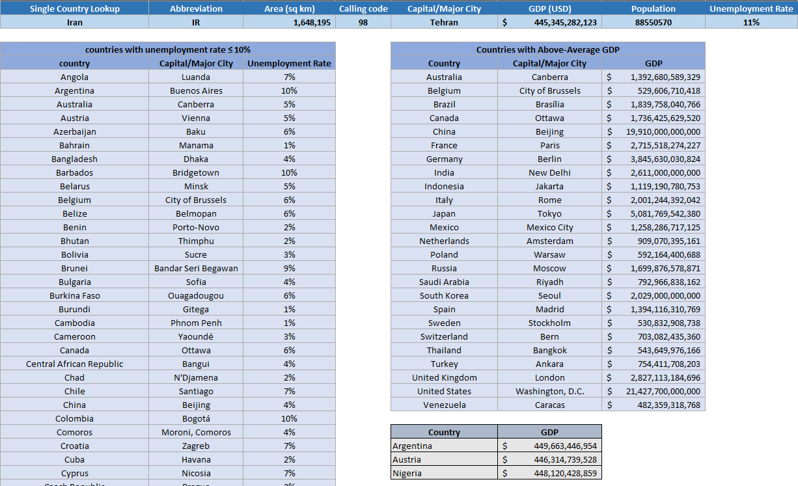

# 03. Global Economic Indicators Analysis in Excel

This project demonstrates advanced Excel formulas, dynamic array functions, and data lookup techniques using global economic data.

## 🛠️ Features & Formulas Implemented
1. **Data Table Creation:** Structured a comprehensive dataset of global countries containing capitals, populations, areas, abbreviations, calling codes, GDP, and unemployment rates.
2. **Interactive Lookup (`XLOOKUP`):** Designed an interactive single country lookup dropdown that automatically retrieves all relevant details.
3. **Filtered Dynamic Arrays (`FILTER` & `SORT`):**
   - Filtered countries with an unemployment rate $\le 10\%$.
   - Filtered countries with a GDP above the global average.
4. **Ranking (`RANK`):** Computed the ranking of each country based on its GDP.
5. **Proximity Filtering:** Implemented dynamic array formulas to find countries with a GDP close to a selected country (e.g., Iran $\pm 5\%$).

## 📸 Output & Visualization

