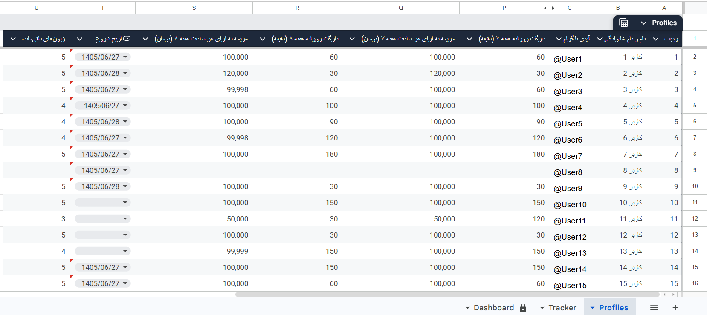
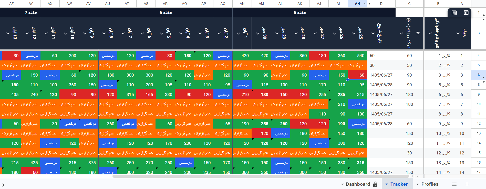
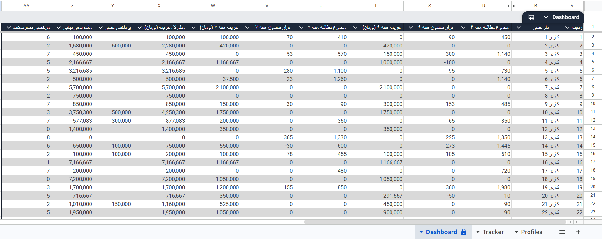
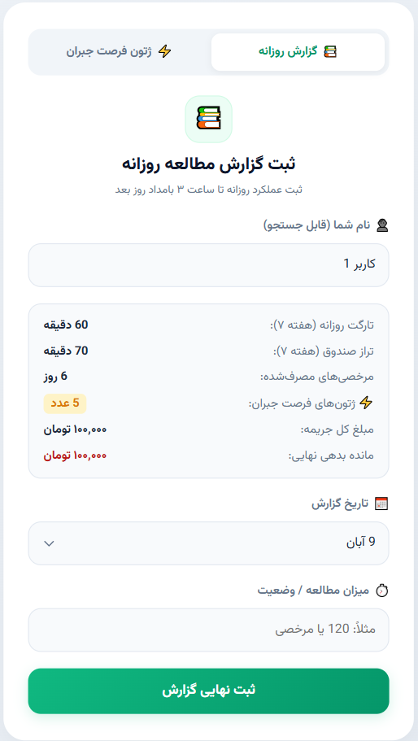
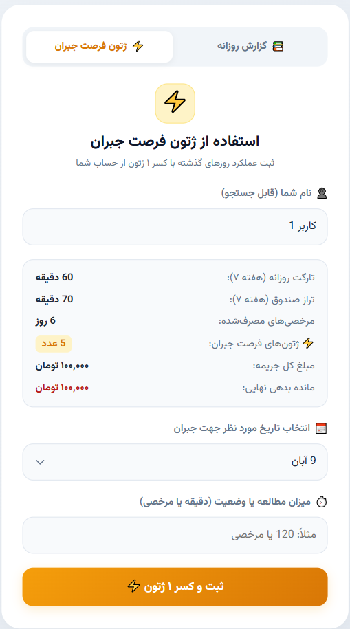

# Study Challenge Tracker

A Google Sheets and Google Apps Script system built to support
a 40-day study challenge for 141 participants.

The project combines participant profiles, daily study tracking,
performance reporting, and a web interface for submitting daily
reports and using recovery tokens.

## Live Demo

- [View the Google Sheets demo](https://docs.google.com/spreadsheets/d/1sn-WotucQq3fMF24_lRxMR3worHgyVxP14vVL0du_kY/edit?gid=654048142#gid=654048142)
- [Open the web app demo](https://script.google.com/macros/s/AKfycby2RD-90TJrQqkfWMAa1DKDSbKwEDVA_cLs76o0pdvCWXT4e6bPWU6C9EZnfO_p5Vb5/exec)

The public demo uses sample participant identities rather than
real names or Telegram usernames.

The web app demo is connected to a separate demonstration spreadsheet,
not the original operational spreadsheet.

## Features

- Participant profiles and study target settings.
- Daily study tracking.
- Dashboard summaries of participant performance.
- Tracking of exemptions, recovery tokens, and calculated penalties.
- A web form for submitting daily study reports.
- A web form for using recovery tokens.

## Tools

- Google Sheets
- Google Apps Script
- HTML, CSS, and JavaScript

## Screenshots

### 1. Participant Profiles

### 2. Daily Study Tracker

### 3. Dashboard

### 4. Daily Report Form

### 5. Recovery Token Form

## Source Files

The `apps-script/` directory contains the Apps Script source files:

- `Code.gs`
- `WebApp.gs`
- `Index.html`
- `appsscript.json`

## Platform Note

This project is designed for Google Sheets and Google Apps Script.
An Excel export is not included because it does not preserve the
full functionality of the system.
